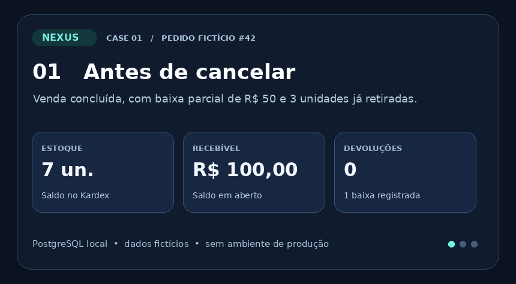

# Nexus Industrial | Cancelar uma venda sem desencontrar estoque e financeiro

## O problema

Uma venda concluída registra uma saída no Kardex e abre um recebível. Se a operação desfizer só um desses lados, o estoque deixa de bater ou o financeiro continua cobrando um valor que não é mais devido.

## A decisão

O cancelamento parte do **pedido de venda**. No código versionado, o [serviço de pedidos](../../src/react/features/pedidos/services/pedidosApi.ts) chama a rotina SQL `pedido_cancelar_seguro`. A [rotina arquivada](../../sql/legacy_archive/73_limpeza_pedidos_cancelados.sql) bloqueia o pedido durante a operação, cancela o recebível, remove as baixas registradas e lança a devolução no Kardex. Se uma etapa falhar, o conjunto é desfeito. Se o pedido já estiver cancelado, a chamada retorna sem criar um novo movimento.

A remoção da baixa neste exemplo é uma operação interna do ERP; não representa um estorno bancário ou de cartão.

## Demonstração com dados fictícios



Venda fictícia **#42**: 3 unidades por R$ 150, com baixa parcial de R$ 50.

| Registro | Antes | Depois |
| --- | --- | --- |
| Pedido | Concluído | Cancelado |
| Saldo do produto no Kardex | 7 unidades | 10 unidades |
| Recebível | Parcial: R$ 100 em aberto | Cancelado: R$ 0 em aberto |
| Baixas registradas | 1 | 0 |
| Movimentos de devolução | 0 | 1, mesmo após repetir o cancelamento |

## Reproduzir localmente

Na raiz do repositório, com Node.js 20 ou superior e npm:

```sh
npm ci --prefix tests/portfolio/nexus-cancelamento --ignore-scripts
npm run demo:case:nexus
npm run test:case:nexus
```

A demonstração usa PostgreSQL em memória via PGlite. Ela carrega a rotina SQL arquivada do repositório em um esquema mínimo de teste e só depois insere os registros fictícios. Não conecta ao Supabase nem requer credenciais ou acesso a dados de clientes.

O teste consulta os registros dos dois módulos e valida três casos:

1. O cancelamento repõe o estoque e encerra o recebível; repetir a chamada não duplica a devolução.
2. Uma falha forçada no lançamento do Kardex mantém o pedido, o estoque, o recebível e a baixa no estado anterior.
3. Um pedido marcado com NF-e emitida é recusado sem alterar estoque nem financeiro.

A prévia ilustra a saída do teste local, não é uma gravação do ERP em execução. O teste não cobre a interface, a autenticação real, integrações de pagamento nem confirma qual revisão da rotina está instalada em produção.
